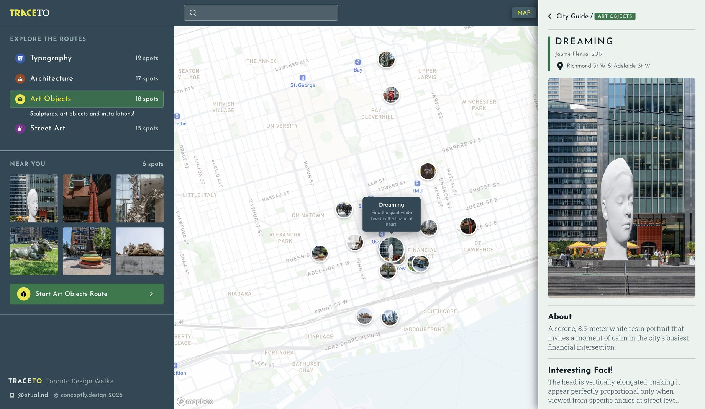

<a href="https://tracedesign.art"></a>

# Trace

A walking map of Toronto’s design landmarks: lettering and ghost signs, street art, public art objects and architecture, each with a hint to help you find it.

[Live site](https://tracedesign.art) · [Case study](https://conceptly.design/case/trace-design)

## What it does

- **Map:** a Mapbox map with filterable routes, photo markers, animated route paths and a bottom drawer for spot details on mobile.
- **City Guide:** a searchable catalogue of every spot, filtered by route and sorted A–Z or by distance.
- **About and Profile:** the story behind the routes, and a preview of route progress and badges.
- **Light and dark themes** from one set of design tokens.

## Routes

| Route | Spots | Data |
|---|---|---|
|  | 12 | `site/js/data-typography.js` |
|  | 15 | `site/js/data-street-art.js` |
|  | 18 | `site/js/data-artefacts.js` |
|  | 17 | `site/js/data-architecture.js` |
|  | 10 | coming back once all ten are walked |

<sub>The Artist’s Pick is ten places recommended by Toronto muralist Jerry “Birdo” Rugg. It’s hidden on the live site until I’ve walked all ten.</sub>

## Built with

`HTML` `CSS` `JavaScript (vanilla)` `Mapbox GL JS` `GeoJSON` `Netlify` `Figma`

Design system: light and dark colour tokens checked for WCAG AA, a 4px spacing grid, two corner radii, Josefin Sans and Roboto Slab. The tokens live in Figma and in the CSS custom properties.

## What’s in this repo

```
site/                    the live site: 4 pages, CSS, JS modules, images
map-data/                GeoJSON and CSV for each route, plus the Mapbox map style
documentation/           style guide, design and build notes, 404 page concepts
screenshots-and-drafts/  early drafts and concept pages
```

## Run it locally

```
npx serve site
```

<sub>The map uses the public Mapbox token in `site/js/map.js`. If it’s restricted to tracedesign.art, add your own.</sub>

## How it was made

I designed the system and every screen in Figma, walked and photographed each spot, wrote the descriptions and hints, and built the GeoJSON. I wrote the code with an AI coding assistant, working from the Figma files and reviewing every change. Trace started as my capstone at Humber and I’m still refining it.

---

<sub>© Etual Fomina. The code is open to read; the photos and texts are not for reuse without permission.</sub>
